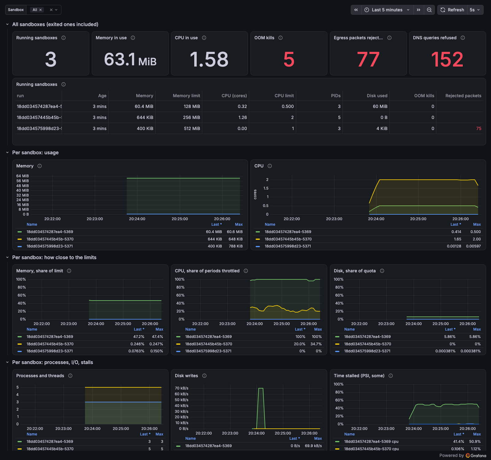

# kiln

A small Linux sandbox runtime, written in Rust, for running AI agent tool calls.
Built layer by layer to learn how containers actually work.

## Security status

kiln is an **experimental, shared-kernel** runtime. Every sandbox runs on the
host's kernel, so a kernel bug reachable from inside a sandbox can compromise
the host. The design and code have been reviewed adversarially by AI models
(see [From the first review](#from-the-first-review) and
[From the second review](#from-the-second-review)), but **not audited by a
professional security firm**. Do not use kiln as a security boundary for
hostile multi-tenant workloads.

Known limits:

- All sandboxes share one host UID/GID range (2000000000-2000065535), so the
  user ID does not separate one sandbox from another.
- The seccomp filter is a denylist of risky syscalls, not an allowlist.
- One-shot `kiln run` preserves the caller's terminal. The injection ioctls
  are blocked, but untrusted interactive code can still read input, change
  terminal settings and print escape sequences. Redirecting stdio alone does
  not remove `/dev/tty`; see [SECURITY.md](SECURITY.md).
- kiln runs as root, and so do its host services, `kiln dns` and
  `kiln metrics`. The optional Prometheus and Grafana stack also runs on the
  host. A bug in any of them is a bug on the host.
- The supported and dogfooded environment is Ubuntu 24.04 with Linux 6.8 or
  newer, in the Lima VM below. Other distributions and kernels are untested.

Report vulnerabilities privately as described in [SECURITY.md](SECURITY.md).

## Dev setup (macOS)

macOS has no namespaces or cgroups, so kiln builds and runs inside a Linux VM.
[`lima.yaml`](lima.yaml) mounts `~/Projects/lambda-nine/kiln` on the Mac
read-write into the VM at the same path, and the sibling
`~/Projects/lambda-nine/kilnd` checkout (the control daemon) the same way.
Create `~/Projects/lambda-nine/kilnd` first, or drop that entry, before
`limactl create`. If you cloned kiln somewhere else, edit the `mounts` entries
in `lima.yaml` before `limactl create`, and run the commands below from the
clone inside the VM. The checked-in template targets
Apple silicon and uses Apple's Virtualization framework with virtiofs (macOS
13 or newer); other Mac architectures and VM backends are untested.

```sh
brew install lima
limactl create --name=kiln lima.yaml && limactl start kiln
limactl shell --workdir "$PWD" kiln      # now in Ubuntu 24.04
sudo scripts/fetch-alpine.sh             # once: unpack Alpine as the "alpine" image
sudo scripts/setup-storage.sh            # once: XFS with project quotas for --disk
scripts/install.sh                       # once: /usr/local/bin/kiln + kiln-dns and kiln-metrics services
scripts/setup-monitoring.sh              # once: Prometheus + Grafana on http://localhost:3000
cargo build
sudo target/debug/kiln run -- sh
sudo target/debug/kiln run --keep -- sh  # keep the run dir to see what changed
sudo target/debug/kiln run --memory 64M --cpus 0.5 --pids 32 --disk 100M --stats -- sh
sudo target/debug/kiln run --read-only --writable /data -- sh  # Landlock
sudo target/debug/kiln run --net full -- wget -qO- http://example.com
sudo target/debug/kiln run --allow example.com:80 --stats -- sh
id=$(sudo target/debug/kiln create --memory 512M --pids 128 --disk 1G)
sudo target/debug/kiln exec "$id" -- sh -c 'echo hello >/workspace/message' </dev/null >/dev/null 2>&1
sudo target/debug/kiln exec "$id" -- cat /workspace/message </dev/null 2>&1 | cat
sudo target/debug/kiln ls
sudo target/debug/kiln rm "$id"
sudo target/debug/kiln gc                 # clean state from crashed shims
sudo KILN_TRACE=1 target/debug/kiln run -- true  # time each startup phase
sudo kiln stats                          # running sandboxes, like docker stats
sudo scripts/metrics-demo.sh             # 3 minutes of load for the dashboard
```

`fetch-alpine.sh` accepts only a strict minirootfs basename, checks the
published SHA-256, and verifies the detached release signature against the
pinned Alpine release key. It builds the image in a same-filesystem staging
directory and atomically exchanges it with the installed image.

### Tests

CI ([`.github/workflows/ci.yml`](.github/workflows/ci.yml)) runs on Ubuntu
24.04 x86_64 for every push and pull request: the Python benchmark-harness
tests, `cargo test`, `cargo clippy` with warnings as errors, shell syntax
checks, JSON validation and `git diff --check`. None of it needs root.

The privileged namespace, network, quota and lifecycle regression checks are
still manual. Run them in the Lima VM after `scripts/install.sh`:

```sh
scripts/review-regressions.sh
```

## Layers

1. **Namespaces** (done): `clone()` with new UTS, PID, mount and IPC
   namespaces (network comes in layer 6). The sandbox has its own hostname,
   its own `/proc`, and its own System V shared memory, semaphores and
   message queues.
2. **Root filesystem** (done): an overlayfs root, with the Alpine image as the
   read-only lower layer and a per-run upper layer. `pivot_root` swaps it in and
   the host's root is detached. `/dev` is a tmpfs with only a few safe devices.
   The run directory is deleted afterwards unless you pass `--keep`.
3. **cgroups v2** (done): each run gets `/sys/fs/cgroup/kiln/<run-id>` with
   `memory.max` (default 512M, no swap, whole sandbox killed on OOM), `cpu.max`
   (default 1 core) and `pids.max` (default 128). The sandbox has its own cgroup
   namespace and a read-only view of its own limits at `/sys/fs/cgroup`.
   `--stats` prints peak memory, CPU time, throttling and OOM kills on exit.
4. **User namespaces** (done): root inside the sandbox is uid 2000000000 on
   the host. The sandbox maps IDs 0..65535 to 2000000000..2000065535, and image
   files are shifted into that range when fetched. The user namespace is
   created *last*, after all mounts, so every other namespace stays owned by
   the host: sandbox root can't mount, unmount or change the hostname.
5. **seccomp and Landlock** (done): every sandbox gets `no_new_privs` and a
   hand-written seccomp-bpf filter that denies ~40 risky syscalls (kernel
   modules, `bpf`, `io_uring`, `keyctl`, `perf_event_open`, the mount API,
   `open_by_handle_at`, clock changes) and any `clone`/`unshare` that creates a
   namespace. `--read-only` adds a Landlock ruleset: read and execute anywhere,
   write only beneath `/tmp`, `/root`, `/workspace`, `/dev/shm` and
   `--writable` paths, even as root. Existing `/dev` files (`/dev/null`,
   `/dev/tty`, ...) stay writable, but nothing new can be created in `/dev`.
6. **Networking** (done): every sandbox has its own network namespace.
   `--net none` (default) is loopback only. `--net full` gets a veth pair on
   the `kiln0` bridge (10.88.0.0/16), NAT to the internet, and nftables rules
   that reject private and link-local ranges (the VM's LAN, the Mac, cloud
   metadata). `--allow HOST[:PORT]` or `--allow IP[/PREFIX][:PORT]`
   (repeatable) allows only those destinations. Sandboxes can't reach the host or each other. DNS goes only
   to `kiln dns`, a small forwarder on the bridge (10.88.0.1) run by the
   `kiln-dns` systemd service: with `--allow` it resolves only the allowed
   names (and their subdomains), and it logs every query to the journal
   (`journalctl -u kiln-dns -f`).
7. **Startup overhead** (done): randomized v2 measurements on one ARM Lima VM
   show that there is no universal “cold-start” number. After 5 seconds idle,
   a one-shot `kiln run -- true` CLI lifecycle (setup, command and synchronous
   cleanup through CLI exit) was
   14.9 ms p50, essentially bare crun's 14.8 ms; Docker was 140.9 ms. Across
   five fresh boots at a defined 100 ms gap, the paired geometric mean of
   Docker/kiln per-boot median ratios was 25.84× (95% session-bootstrap
   interval 23.82–27.82×). `true` is an
   overhead microbenchmark, and the stacks do different work on different
   storage paths. Across three boots the Docker/kiln ratio narrowed, as
   expected, to 4.67× for the Python workload, 3.81× for Node and 2.15× for an
   HTTP GET. The wider suite covers Docker, Podman, nerdctl/containerd, runc,
   crun, youki and gVisor, plus concurrency and memory slopes. Most of kiln's
   original overhead was RCU waits and helper processes. A corrected network
   concurrency run also found and fixed a veth-reuse race; the failed run is
   preserved and excluded, and its fresh-boot replacement completed without a
   failure. Full method, raw-data boundaries and analysis:
   [docs/benchmarks.md](docs/benchmarks.md); `KILN_TRACE=1` prints each phase.
8. **kiln-init** (done): PID 1 inside the sandbox is kiln itself. It forks the
   command as PID 2, forwards SIGTERM/HUP/USR1/USR2 to it, reaps orphans, and
   exits with the command's code. The host-side `kiln` survives Ctrl-C and
   `kill`, passes them on, and still cleans up.

9. **Disk limits** (done): `/var/lib/kiln/runs` is an XFS filesystem (in a
   sparse file on a loop device) mounted with `prjquota`. Each run directory
   gets its own project ID with PROJINHERIT and hard block and inode limits
   (`--disk`, default 1G; one inode per 16 KiB of it, at least 128). Done with raw `FS_IOC_FSSETXATTR` ioctls and
   `quotactl_fd`.

10. **Metrics** (done): `kiln metrics` serves every running sandbox's memory,
    CPU and throttling, PIDs, block I/O, pressure stalls, disk quota use,
    network traffic and rejected packets in the Prometheus text format on
    127.0.0.1:9840, read straight from cgroup files, XFS quotas, veth
    counters and nftables. `kiln dns` counts forwarded and refused queries on
    127.0.0.1:9841. `scripts/setup-monitoring.sh` installs Prometheus (scraping
    every 5 s), node_exporter and Grafana with the dashboard below provisioned
    from `monitoring/`. `kiln stats` prints the same numbers as a table.
    Grafana's admin password is generated on install; read it with
    `sudo sed -n 's/^GF_SECURITY_ADMIN_PASSWORD=//p' /etc/grafana/kiln-admin.env`.

11. **Persistent sandboxes** (done): `kiln create` starts a detached host shim
    and a locked-down PID 1, prints the sandbox ID, and returns. `kiln exec`
    passes redirected standard streams to PID 1 and runs each command with the
    sandbox's existing namespaces, cgroup limits, seccomp filter and Landlock
    policy. It refuses terminal descriptors until kiln has a controlled PTY
    mode; redirect all three streams as in the example above. The overlay and
    `/workspace` survive between commands. Each command runs in its own
    process group; if the `kiln exec` client goes away before it finishes
    (killed, or timed out by a caller), PID 1 kills that group and keeps
    serving, so the sandbox stays usable. A request that cannot start because
    `pids.max` is full also fails without taking PID 1 or the sandbox down.
    `kiln exec` exits with the command's code (128 + signal if it was killed),
    or 125 when kiln itself fails, for example because the sandbox is gone.
    `kiln ls` lists live and stale shims, `kiln rm` stops one and waits for its
    resources to be removed, and `kiln gc` removes cgroups, network state and
    run directories left by crashed shims. One-shot `kiln run` is unchanged.



See [ARCHITECTURE.md](ARCHITECTURE.md) for where this is going.

## Notes

- **PID 1 ignores signals from inside its own namespace.** `kill -9 $$` inside
  `kiln run -- sh` does nothing: the kernel drops signals sent to a namespace's
  init from within it unless init installed a handler. A `kill -9` from the host
  works (exit code 137). This is why containers often run a tiny init like `tini`.
- **Mount propagation.** On systemd hosts `/` is a shared mount, so a new mount
  namespace still sends new mounts back to the host. kiln marks `/` private
  (`MS_REC | MS_PRIVATE`) before mounting anything.
- **Overlay deletes are "whiteouts".** Deleting `/etc/motd` in the sandbox
  can't touch the read-only image, so overlayfs records it in `upper/` as a
  character device with number 0/0. `rm -rf /bin` inside a sandbox leaves the
  image intact, and `upper/` is an exact record of what a run changed. For an
  agent, that record is a free audit log.
- **pivot_root, not chroot.** `chroot` only changes how paths resolve and can be
  escaped. `pivot_root(".", ".")` stacks the old root on top of the new one;
  `umount2(".", MNT_DETACH)` then removes it, so nothing reaches the host
  filesystem. It fails with `EINVAL` if the mounts are still shared, another
  reason for the `MS_PRIVATE` step.
- **No mount cleanup needed.** The overlay is mounted inside the sandbox's
  mount namespace, so the kernel tears it down when the last process exits. The
  host never sees it (`findmnt -t overlay` stays empty during a run).
- **Getting into a cgroup before the command runs.** kiln creates the cgroup
  first and starts the child inside it with `clone3(CLONE_INTO_CGROUP)`, so
  its limits apply from its first instruction. The older way is to clone,
  write the child's PID to `cgroup.procs`, and only then let it continue
  through a pipe. That move is slow: the kernel takes
  `cgroup_threadgroup_rwsem` for writing, which waits for an RCU grace period
  (5-15 ms on this VM unless another process was moved just before). It was
  the largest part of a `--net none` cold start.
- **Controllers are enabled top-down.** A cgroup can only use `memory`, `cpu`
  or `pids` if its parent lists them in `cgroup.subtree_control`, and a cgroup
  that hands controllers to children can't hold processes itself ("no internal
  processes"). That's why runs live under `/sys/fs/cgroup/kiln/` and not in it.
- **CPU limits are quotas per 100 ms period.** `--cpus 0.25` writes
  `25000 100000` to `cpu.max`. A busy loop for 2 s then gets 500 ms of CPU and
  is throttled once in each of 20 periods (see `nr_throttled` in `cpu.stat`).
- **The cgroup namespace must come after the move.** It makes the process's
  *current* cgroup look like `/`. Unshare it before joining the sandbox's cgroup
  and the host's cgroup becomes the root instead.
- **PID 1 bites again.** Before kiln-init, `kiln run -- timeout 2 sh -c
  'while :; do :; done'` never ended: busybox `timeout` sends SIGTERM from
  inside the namespace, and PID 1 ignored it. Now the command is PID 2 and it
  exits after 2 s with code 143.
- **Waiting for signals instead of handling them.** Both kiln-init and the
  host-side `kiln` block signals with `sigprocmask` and pick them up one at a
  time with `sigwait`, in the same loop that reaps children. No async signal
  handlers, so no async-signal-safety rules to get wrong.
- **Don't forward Ctrl-C.** The terminal sends SIGINT to its whole foreground
  process group, and the sandboxed command is in that group, so it already got
  the signal. Forwarding it too would deliver it twice. Ctrl-C ends a run with
  130 and everything is cleaned up.
- **Project quotas cap a directory tree, not a user.** Classic quotas limit
  what a UID owns. XFS project quotas limit whatever is tagged with a project
  ID, and PROJINHERIT makes new files inherit the tag from their directory.
  kiln uses the run directory's inode number as the ID. Inspect live usage
  with `sudo xfs_quota -x -c 'report -p -h' /var/lib/kiln/runs`.
- **A full quota looks like a full disk.** XFS returns `ENOSPC` ("No space
  left on device"), not `EDQUOT`, when a project hits its limit.
- **Writing files costs memory too.** Writing 100 MB to disk showed a memory
  peak of about 100 MiB: page cache is charged to the writer's cgroup. It's
  reclaimable, so it causes writeback rather than OOM kills, but it counts
  toward `memory.max`.
- **Create the user namespace last.** Each namespace is owned by the user
  namespace that was current when it was created, and capabilities only work
  on namespaces your user namespace owns. kiln does all its mounts as real
  root, then calls `unshare(CLONE_NEWUSER)`. Sandbox root has a full set of
  capabilities (`CapEff: 000001ffffffffff`) that apply to nothing that matters:
  `hostname`, `mount` and `umount` all fail with EPERM.
- **Only an outsider can write the ID maps.** A new user namespace starts with
  no mapping, so the process shows up as `nobody`. The parent (outside it)
  writes `0 2000000000 65536` to `/proc/<pid>/uid_map` and `gid_map`, then the
  child switches to uid 0. That's a second pipe handshake, child → parent.
- **Image files must be shifted.** Inside the sandbox, host-root-owned files
  look like they belong to `nobody`, and sandbox root can't change them. So the
  fetch script adds 2000000000 to every file's owner, and puts setuid bits back
  since `chown` clears them. That's Docker's userns-remap approach. Idmapped
  mounts (`mount_setattr` with `MOUNT_ATTR_IDMAP`) would avoid the copy and
  allow a different ID range per sandbox; all sandboxes share one range today.
- **A seccomp filter is a tiny BPF program.** It runs on every syscall with
  `struct seccomp_data` (syscall number, architecture, args) and returns an
  action. kiln's checks the architecture first (syscall numbers differ per
  arch, so a mismatch kills the process), then compares the number against the
  denylist. Check it's active with `grep Seccomp /proc/self/status`.
- **Why block namespace creation.** Sandbox root has every capability inside
  its user namespace, so `unshare(CLONE_NEWNET)` would succeed and expose
  netfilter and other root-only kernel code. The filter tests `args[0]` of
  `clone` and `unshare` against all `CLONE_NEW*` bits. `clone3` hides its flags
  in a struct the filter can't read, so it gets `ENOSYS` and libc falls back to
  `clone`, the same trick Docker uses.
- **no_new_privs.** Required before an unprivileged process can install a
  seccomp filter or Landlock ruleset: once set, exec can never grant more
  privilege (setuid bits stop working), so the filter can't be escaped through
  a setuid binary. `su` from root to a user still works; it only drops.
- **Landlock binds root.** File permissions don't stop root (`CAP_DAC_OVERRIDE`),
  but Landlock is checked separately: with `--read-only`, sandbox root gets
  "Permission denied" writing `/etc/motd`. A ruleset only has grants, no denies:
  you list the rights you "handle", and anything handled is denied unless a
  rule grants it beneath some directory.
- **The network namespace is created before the user namespace**, like the
  others, so sandbox root can't run `ip link set eth0 down`, change its address
  or routes, or touch the firewall. The host creates the veth pair with one
  end directly in the sandbox's namespace (`IFLA_NET_NS_PID`), and kiln-init
  sets up its side (loopback, eth0's address, the default route) while it's
  still real root. Both speak rtnetlink (`netlink.rs`), the protocol `ip`
  itself uses, instead of spawning `ip` and `nsenter`.
- **Two sysctls make root-in-a-userns feel normal.** Binding ports below 1024
  needs `CAP_NET_BIND_SERVICE` in the user namespace that *owns* the network
  namespace, which sandbox root isn't. Setting
  `net.ipv4.ip_unprivileged_port_start=0` and `net.ipv4.ping_group_range` inside
  the namespace lets it bind port 80 and ping. Docker sets the same two.
- **Policy is one verdict map.** `iifname "kiln0" ip saddr vmap @egress` jumps
  to a per-sandbox chain keyed by its IP. Adding or removing a sandbox is one
  map element plus one chain, with no rule handles to track. Rules end in
  `reject with icmpx admin-prohibited` rather than `drop`, so blocked
  connections fail in milliseconds ("Host is unreachable") instead of hanging.
  Look at it with `sudo nft list table inet kiln`.
- **The shared firewall is reconciled, not merely detected.** Under the network
  lock, kiln restores the private-address set and replaces any noncanonical
  input, forward or NAT hook chain in one nft transaction. Active sandbox
  chains and verdict-map entries remain in place. It checks everything from
  one `nft -s list table` and commits nothing when the ruleset is already
  canonical, which is every run but the first after boot.
- **Conntrack is bounded per sandbox IP.** Before egress policy, a dynamic nft
  set rejects new flows once an IP has 256 conntrack entries. The count for an
  IP is reset when a sandbox using it starts or stops, so a new sandbox on a
  reused IP isn't locked out by the previous one's flows (the trade-off: until
  those old flows expire, the host table can briefly hold more than 256 for
  that IP). `kiln metrics` reports the rejected packets.
- **Sandbox-to-sandbox traffic never hits the firewall.** Frames between two
  ports of the same bridge are switched, not routed, so the inet forward hook
  never sees them. kiln sets `isolated on` for each bridge port instead.
- **IP leases are reconciled under the network lock.** A lease is a file in
  `/run/kiln/net/leases` created with `O_EXCL`. Before allocation, kiln removes
  a stale lease only when its run has no cgroup, veth, nft map entry or live
  supervisor. `/run` is a tmpfs, so all leases also vanish on reboot.
- **DNS inside the sandbox.** systemd-resolved's `127.0.0.53` only exists in the
  host's namespace. `kiln-dns` reads the host's real upstream resolvers and
  listens on the bridge; kiln writes only `nameserver 10.88.0.1` into the
  sandbox's `/etc/resolv.conf` as real root, which makes it read-only for
  sandbox root.

### From the first review

Four independent model reviewers attacked kiln after the networking commit
`eebaf81`. This was an
adversarial engineering review, not a professional security audit. What they
found, and what each fix teaches:

- **No IPC namespace meant shared System V IPC.** One sandbox created a private
  shared-memory segment; a later sandbox read, changed and deleted it. User
  namespaces didn't help, because every sandbox maps to the same host IDs.
  Segments also outlived their sandbox, so they could leak memory past
  `memory.max`. Fix: `CLONE_NEWIPC`; the kernel frees everything in it when the
  namespace dies.
- **Inherited file descriptors go straight through every wall.** A host file
  opened as fd 9 by whoever ran kiln was readable *and writable* inside a
  `--read-only` sandbox. Namespaces, `pivot_root` and Landlock check paths at
  open time; they don't revoke descriptors already open. This is the same class
  of bug as runc's CVE-2024-21626. Fix: the child closes every fd except
  0/1/2 and its two pipe ends first thing (`close_range`).
- **conntrack outlives sandboxes.** IPs are leased lowest-first, so the next
  sandbox usually gets the previous one's IP. With `ct state established
  accept` first in the forward chain, a restricted sandbox could continue a UDP
  flow only the previous sandbox was allowed. Fix: every outbound packet goes
  through the sandbox's current policy; "established" is only trusted for
  replies coming back in.
- **`nft add chain` is idempotent, so a leftover chain's rules win.** Fix:
  `flush chain` right after `add chain`.
- **Smaller fixes:** `--image` must be a plain name (it accepted `../..`);
  size flags check for overflow; seccomp uses `SECCOMP_FILTER_FLAG_TSYNC` so a
  future multi-threaded daemon can't leave a thread unfiltered; `/dev/shm`
  exists (64 MB tmpfs, charged to the sandbox's memory); the sandbox dies with
  its supervisor (`PR_SET_PDEATHSIG`, set after the credential change that
  would clear it); `--read-only` needs Landlock ABI 3 so truncation is covered.
- **Simplifications:** one nftables table (NAT works in `inet` tables, and the
  old second table was never recreated if missing); the veth peer is created
  directly inside the sandbox as `eth0`; the sandbox writes its two network
  sysctls itself through `/proc/sys/net` (which is per network namespace)
  instead of via `sh` and `sysctl`; Landlock only handles write rights; kiln's
  own mount points live in the image, so `upper/` holds only what the sandbox
  wrote (plus `resolv.conf` when networked).
- **Known limits, documented rather than fixed:** `--read-only` covers file
  contents and directory entries but not metadata (`chmod` on a file the
  sandbox owns still works), and DNS to the host's resolver was allowed over
  TCP and UDP, which on Lima means a port on the Mac. The DNS forwarder
  (below) has since closed that.

### DNS, disk I/O, and a loop-device OOM

- **A DNS forwarder closes the last way out.** Before, every networked sandbox
  could reach the VM's resolver directly, which on Lima is a port on the Mac,
  and could leak data through query names (`<secret>.attacker.com`). Now the
  only resolver a sandbox can reach is `kiln dns` on 10.88.0.1. It looks up
  the asking sandbox's policy by source IP (`/run/kiln/net/dns/<ip>`): `*` for
  `--net full`, otherwise only the `--allow` hostnames. Anything else gets
  `REFUSED`. It parses just enough of the DNS wire format to read the question:
  a 12-byte header, then length-prefixed labels.
- **`O_DIRECT` writes could OOM-kill a sandbox.** Sandbox storage is XFS
  inside a file on a loop device. By default the loop driver writes that
  backing file through the page cache, and the kernel charges those pages to
  the sandbox that caused the I/O. A sandbox writing 1.5 GB with `O_DIRECT`
  under a 512 MB limit was OOM-killed: its own writes bypassed the cache, so
  the only pages it had were the loop driver's dirty ones. Setting direct I/O
  on the loop device (`LOOP_SET_DIRECT_IO`) fixed it (memory peak 2.4 MiB),
  and made writes faster. It doesn't survive a reboot, so kiln sets it on
  every run (`storage.rs`).
- **`io.weight` needs a proportional I/O controller.** This VM's disk uses
  `mq-deadline` and the kernel has no BFQ, so weights did nothing. kiln turns on
  iocost for the real disk under the loop device (`io.cost.qos`) and gives
  all sandboxes together half the weight of host services. With loop direct
  I/O, a sandbox's writes show up on the real disk under its own cgroup
  (`io.stat` for 253:0, with `cost.usage`). Honest result: on this VM it
  doesn't change throughput yet. iocost only enforces weights when its model
  says the disk is saturated, and the Mac's SSD behind virtio never gets
  there with the default model. Tuning `io.cost.model` would be the next step.

### Metrics

- **The exporter has no state.** Every scrape reads the kernel's own
  counters: `memory.current`, `cpu.stat`, `pids.current`, `io.stat` and the
  `*.pressure` files in each sandbox's cgroup, the XFS project quota of its run
  directory, `/sys/class/net/kvNNNN/statistics` for its veth, and `nft list
  table inet kiln`. The text format is simple enough to write by hand: `# HELP`
  and `# TYPE` lines, then `name{label="value"} number`. Counters end in
  `_total` and only go up; Grafana turns them into rates with `rate()`.
- **Short runs fall between scrapes.** A sandbox that's OOM-killed half a
  second after it starts never shows up in a 5 s scrape; its cgroup is gone.
  The parent cgroup saves the day: `/sys/fs/cgroup/kiln/memory.events` and
  `cpu.stat` are hierarchical and keep counting sandboxes after they're
  removed, so `kiln_all_oom_kills_total` and `kiln_all_cpu_seconds_total`
  include every run since boot. Not everything aggregates: the parent's
  `nr_throttled` only counts throttling by the parent's own limit, so
  throttling is per sandbox only.
- **Same idea for the firewall.** A sandbox's nftables chain (and its
  counters) is deleted when it exits, so each reject also bumps a named
  counter, `egress_rejected`, that lives as long as the table. One rule can
  carry two counters: `counter name "egress_rejected" counter reject`.
- **An OOM kill counts processes, not sandboxes.** With `memory.oom.group`
  the kernel kills every process in the sandbox at once, and `oom_kill` goes
  up by one per process.
- **Throttling as a share of periods.** `nr_throttled / nr_periods` is the
  share of 100 ms periods in which the sandbox used up its `cpu.max` quota and
  was paused. A busy loop under `--cpus 0.5` sits at 100%. Pressure stall
  information (`cpu.pressure`) shows the same thing as time: about 50% of
  wall time spent waiting for CPU.
- **A veth pair is a mirror.** The sandbox's bytes sent show up as bytes
  *received* on the host end (`rx_bytes`), so the exporter swaps them.
- **Page cache counts as memory.** Writing 60 MB to disk shows ~60 MiB of
  `file` memory in `memory.stat` (and in `memory.current`), with almost no
  `anon` memory. It's reclaimable, so it doesn't cause OOM kills.

### From the second review

A separate security-focused model reviewed kiln after the metrics layer,
including the host-side services. All five findings are fixed.
The regression suite directly exercises the DNS worker bound and inode quota;
the metrics worker, journal escaping and Grafana password changes were checked
in their code and service configuration:

- **The DNS forwarder could be made to start unlimited threads.** It spawned
  one per query, so any networked sandbox could exhaust the host's tasks.
  Now 16 workers take jobs from a queue of 256; when it's full, new datagrams
  and TCP connections are dropped and clients retry, which DNS clients do
  anyway. The `kiln-dns` unit also caps tasks (`TasksMax=64`) and memory.
  Anything a sandbox can talk to is part of the wall.
- **The metrics server handled one connection at a time.** One slow client
  held up every scrape. It now has 4 workers and a queue of 32, also
  dropping on overflow.
- **A block quota alone doesn't limit inodes.** Empty files cost almost no
  blocks, so a sandbox could use up the filesystem's inodes under a small
  `--disk`. Each project now also gets an inode limit: one per 16 KiB of
  `--disk`, at least 128.
- **Query names went into the journal as-is.** They're bytes the sandbox
  chose, so they could carry control characters into log lines. The forwarder
  now logs them with control characters escaped.
- **Grafana kept its default admin password.** `scripts/setup-monitoring.sh`
  now generates one into `/etc/grafana/kiln-admin.env` (root-only), passes it
  to Grafana through a systemd drop-in, and resets it on existing installs.
  Read it with `sudo sed -n 's/^GF_SECURITY_ADMIN_PASSWORD=//p'
  /etc/grafana/kiln-admin.env`.

## Contributing

See [CONTRIBUTING.md](CONTRIBUTING.md). Report security issues privately as
described in [SECURITY.md](SECURITY.md), not in public issues. Changes are
listed in [CHANGELOG.md](CHANGELOG.md).

## License

Copyright 2026 Stephen Estrada. Licensed under the
[Apache License, Version 2.0](LICENSE). Notices for Rust dependencies included
in the release binary are in
[THIRD-PARTY-LICENSES.md](THIRD-PARTY-LICENSES.md).
