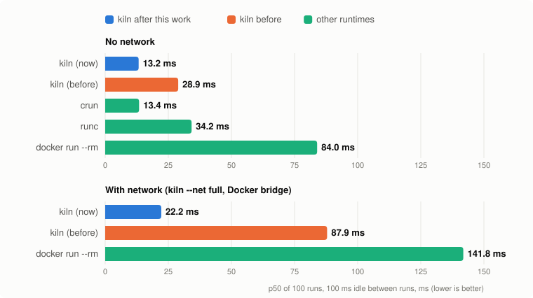

# Benchmarks

## Primary v2 campaign (October 2026)

kiln is built for short-lived, untrusted agent workloads: many sandboxes,
started on demand, often for one command. The v2 campaign measures five parts
of that claim with randomized order and raw per-invocation records:

- lifecycle latency across five fresh VM boots;
- sensitivity to 0, 10, 100, 1000 and 5000 ms of idle;
- throughput and tail latency under barrier-released client loads from 1 to 64;
- marginal host memory across 0, 10, 25, 50 and 100 idle sandboxes;
- six small shell, Python, Node, filesystem, DNS and HTTP workloads, each in
  three fresh-boot sessions.

The main result is architectural, not a single magic number. kiln tracks bare
crun's lifecycle floor while providing more of the sandbox stack itself. At a
defined 100 ms gap, across five fresh boots, Docker's non-networked one-shot
`true` lifecycle was **25.84× kiln's** (95% session-bootstrap interval
23.82–27.82×). But 100 ms is not a stable “cold” state: in a separate idle-gap
sweep, kiln moved from 2.78 ms back to back to 14.88 ms after 5 seconds. Bare
crun moved from 2.58 to 14.80 ms. At that 5-second point Docker took 140.90 ms.

Those observations belong together: kiln is near the low-level runtime floor,
and the absolute floor depends on how recently the VM and kernel paths ran.
This document therefore names the idle gap with every lifecycle result instead
of calling one condition “cold start.”

### Summary

The first table compares complete end-user stacks. Every row is from this one
4-vCPU ARM VM, but the experimental unit differs by row and is stated below.

| measurement | kiln | Docker | Podman + crun | nerdctl + containerd |
|---|---:|---:|---:|---:|
| One-shot `true`, 5 s idle, p50 ms | **14.88** | 140.90 | 109.27 | 147.49 |
| Ratio to kiln at 100 ms, 5 boots | **1.00×** | 25.84× | 17.49× | 27.64× |
| 64-client `true`, mean completions/s | **836.6** | 6.9 | 15.0 | 10.5 |
| Idle memory, median KiB/sandbox slope | **749** | 5007 | 1203 | 13172 |

The 5-second values are 10-run p50s from one exploratory idle-gap sweep. The
100 ms ratios are geometric means of per-boot median ratios across five boots.
Concurrency is three batches in one boot. Memory is the median of three fits in
one boot. Memory that was resident before a point, including existing daemons,
cancels in its before/after delta and is outside the fitted slope and intercept.

The runtime-floor and stronger-isolation cases are separate tiers:

| runtime | tier | 5 s `true` p50 ms | 100 ms ratio to kiln (5 boots) | memory slope KiB | 64-way completions/s |
|---|---|---:|---:|---:|---:|
| crun | low-level OCI | **14.80** | 0.947× (0.868–0.992) | 472 | 827.0 |
| runc | low-level OCI | 34.81 | 4.19× | 434 | 99.5 |
| youki | low-level OCI | 30.96 | 3.58× | 663 | invalid; timed out |
| runsc | stronger isolation | 67.45 | 8.36× | 13986 | 39.3 |

crun being a little faster at the 100 ms condition is not a meaningful kiln
loss: the median absolute difference was under a millisecond in most boots, and
the two converge at 5 seconds. The supported claim is that kiln tracks the bare
crun floor while doing image lookup, overlay setup, a user namespace, seccomp,
a PID 1 and a per-sandbox disk quota.

### Method

`bench/v2.py` starts each command directly, without a shell. Its monotonic
clock begins immediately before `Popen` and stops when `waitpid` returns, so a
one-shot result includes CLI launch, sandbox setup, `true`, waiting and the
runtime's synchronous cleanup through CLI exit. Kernel-deferred destruction,
such as a veth tied to a dying namespace, can finish after the timer. Output
goes to temporary files rather than pipes. A watchdog records
and kills timeouts; spawn errors, signals and non-zero exits are records rather
than reasons to abort the campaign.

In each round every selected case runs once. Seeded randomized Latin squares
balance each case across schedule positions, so drift is not assigned to the
runtime that always happened to run first. The primary latency campaign used
10 warm-up and 100 measured rounds per case at a 100 ms gap on each of five
fresh boots. A session is one boot, verified by `/proc` boot ID. Ratios are
formed from each session's pair of medians; the reported 95% interval is a
10,000-resample percentile bootstrap over sessions. p95 and p99 are
invocation percentiles, not confidence intervals.

The one-boot idle-gap sweep used 2 warm-up and 10 measured rounds at each of
0, 10, 100, 1000 and 5000 ms. Concurrency used three batches at levels 1, 4,
16, 32 and 64. Memory fit `MemTotal - MemAvailable` growth against 0, 10, 25,
50 and 100 running sandboxes after syncing and dropping page cache, with three
randomized repeats. Representative workloads used three fresh-boot sessions
per workload, 40 runs at a 100 ms gap for local workloads and 15 runs at a
1-second gap for DNS/HTTP.

**Environment.** MacBook Air, Apple M2, 24 GiB, macOS 27.0.1; Lima 2.2.1
using `vz`; guest Ubuntu 24.04.5, Linux 6.8.0-146 aarch64, 4 vCPU, 4 GiB,
cgroup v2, no swap. The Mac was under normal use. `/dev/kvm` was absent, so
Firecracker and Kata could not run. Tested versions: Docker 29.1.3,
containerd 2.2.1, runc 1.3.4, crun 1.14.1, Podman 4.9.3, nerdctl 2.4.1,
youki 0.7.0 and gVisor runsc release-20261005.0.

**Matched inputs.** `bench/setup.sh` exports one Alpine rootfs tar and imports
those exact bytes into kiln, Docker, Podman and nerdctl, then creates OCI
bundles for the low-level runtimes. Every case gets 512 MiB memory with no
swap, 1 CPU and 128 PIDs. The expanded workload image is likewise exported
once and imported everywhere. Every manifest records config and artifact
SHA-256s, executable hashes, versions, kernel, boot ID, CPU, memory, cgroup
mode, Git commit and dirty state.

**What is not matched.** Product stacks do different work. kiln uses an XFS
loop device, overlayfs and a project quota; image stacks use their configured
snapshotters; bare OCI runtimes receive an unpacked ext4 tree and prepared
bundle. kiln uses a user namespace and seccomp; bare cases used neither.
Docker and nerdctl cross shared daemons; Podman is daemonless but keeps conmon;
kiln needs no shared daemon for non-networked starts and uses `kiln-dns` for
networked DNS. These are product-level comparisons, not attribution to one
component.

Podman's default `10.88.0.0/16` bridge collided with kiln's `kiln0`. The setup
now creates a dedicated Podman `kiln-bench` bridge on `10.89.0.0/24`. The first
Podman network rows are excluded; the corrected paired rerun is reported below.
Its first concurrency attempt exposed a kiln veth-reuse race and is also
retained but excluded; the reported concurrency row is a fresh-boot rerun after
the fix.

### Lifecycle across idle gaps

No network, one boot, p50 milliseconds (10 measured invocations per point):

| case | 0 ms | 10 ms | 100 ms | 1 s | 5 s |
|---|---:|---:|---:|---:|---:|
| **kiln** | **2.78** | **2.70** | **5.34** | **14.93** | **14.88** |
| crun | 2.58 | 2.57 | 4.60 | 12.50 | 14.80 |
| runc | 13.65 | 14.92 | 22.03 | 36.64 | 34.81 |
| youki | 10.41 | 12.35 | 15.66 | 31.11 | 30.96 |
| runsc | 29.53 | 30.42 | 35.71 | 64.11 | 67.45 |
| Podman + crun | 62.34 | 62.37 | 84.98 | 107.11 | 109.27 |
| Docker | 141.54 | 89.87 | 106.21 | 119.15 | 140.90 |
| nerdctl | 109.40 | 110.48 | 129.33 | 141.59 | 147.49 |

Normal network path. The first three rows are from the all-runtime sweep; the
last two are a separate fresh-boot paired rerun after correcting Podman's
bridge subnet:

| case | 0 ms | 10 ms | 100 ms | 1 s | 5 s |
|---|---:|---:|---:|---:|---:|
| **kiln, all-runtime sweep** | **6.48** | **5.34** | **11.01** | **25.28** | **25.53** |
| Docker | 168.97 | 173.83 | 199.99 | 181.05 | 191.30 |
| nerdctl | 207.85 | 209.72 | 212.32 | 230.03 | 230.75 |
| **kiln, paired rerun** | **5.65** | **6.87** | **8.95** | **25.24** | **23.38** |
| Podman + crun, corrected | 176.69 | 176.02 | 198.19 | 207.94 | 205.93 |

The non-monotonic points are real samples from a noisy laptop VM, not a model
of latency. The stable observation is the regime change: 100 ms does not
reliably let the fastest VM/kernel paths return to their longer-idle state.

### Five-boot 100 ms ratios

Each row is the geometric mean of one median ratio per boot:

| case | baseline | ratio | 95% bootstrap interval |
|---|---|---:|---:|
| crun | kiln, no network | 0.947× | 0.868–0.992× |
| runc | kiln, no network | 4.19× | 3.96–4.39× |
| youki | kiln, no network | 3.58× | 3.31–3.74× |
| runsc | kiln, no network | 8.36× | 7.96–8.81× |
| Podman + crun | kiln, no network | 17.49× | 16.84–18.10× |
| Docker | kiln, no network | 25.84× | 23.82–27.82× |
| nerdctl | kiln, no network | 27.64× | 26.76–28.39× |
| Docker bridge | kiln network | 16.77× | 15.39–18.28× |
| nerdctl CNI | kiln network | 21.04× | 19.58–22.51× |
| Podman bridge, corrected | kiln network | 20.44× | 20.07–20.77× |

Absolute per-boot p50s and every raw invocation are in
`bench/results/v2/macbook-air-2026-10-11/`. The first boot was generally
slower for the daemon-backed stacks; pairing within boot is why the ratio is
the headline statistic.

### Concurrency

One fresh boot, three batches per level. Throughput is successful completions
divided by batch wall time; latency is per invocation.

| case | level 64 mean completions/s | invocation p50 ms | p95 ms | failures |
|---|---:|---:|---:|---:|
| **kiln, no network** | **836.6** | 44.6 | 205.8 | 0 |
| crun | 827.0 | 52.9 | 73.7 | 0 |
| runc | 99.5 | 591.1 | 4067.1 | 0 |
| runsc | 39.3 | 1116.6 | 3975.8 | 0 |
| Podman + crun | 15.0 | 3000.5 | 4662.3 | 0 |
| nerdctl | 10.5 | 3078.2 | 15418.5 | 0 |
| Docker | 6.9 | 6966.5 | 13816.8 | 0 |
| **kiln, network** | **86.7** | 417.1 | 2336.2 | 0 |
| nerdctl, network | 4.4 | 10887.8 | 19682.5 | 0 |
| Docker, network | 5.5 | 9305.0 | 25628.3 | 0 |
| **kiln, network, paired rerun** | **114.4** | 228.8 | 497.4 | 0 |
| Podman + crun, network, corrected | 10.6 | 4775.6 | 5811.9 | 0 |

The three kiln no-network batches ranged from 296.9 to 1243.2 completions/s,
and its network batches from 25.3 to 135.1. That variance is why these values
are exploratory client-load saturation evidence, not capacity promises.
Python's barrier released all client threads together, but starts were not
perfectly simultaneous. At level 64, kiln without networking spread 15.7–20.4
ms; across all original cases the batches ranged from 12.3 ms to 7.87 s, the
widest being one Docker network batch. youki timed out 22 invocations across
levels 4–64 and was removed
from the original campaign's throughput comparison; every other original case
completed every invocation.

The last two rows are a separate corrected pair on one fresh boot. The first
attempt had one of kiln's 351 measured invocations fail at level 16: an older
network namespace removed a reused veth after the new run received `EEXIST`
but before it explicitly deleted the stale link. That entire attempt is stored
under `podman-net-corrected/invalid-concurrency-veth-race` and excluded. Commit
`2cca44a` treats only the resulting `ENODEV` as already-cleaned state and adds a
ten-wave, 160-start concurrent stress check. The replacement produced all 702 invocations
across the pair with zero failures or timeouts. Its three level-64 kiln batches
ranged from 91.6 to 154.0 completions/s, so this remains exploratory.

### Idle memory

Median OLS slope across three randomized fits in one boot:

| case | median KiB/sandbox | range across fits |
|---|---:|---:|
| crun | 472 | 407–486 |
| runc | 434 | 414–549 |
| **kiln, no network** | **749** | **680–837** |
| kiln, network, all-runtime run | 669 | 516–952 |
| youki | 663 | 470–1357 |
| Podman + crun | 1203 | 1063–1383 |
| Podman + runc | 1327 | 1304–1337 |
| Docker | 5007 | 4634–5316 |
| nerdctl | 13172 | 13086–13325 |
| runsc | 13986 | 13833–14242 |
| **kiln, network, corrected pair** | **1101** | **550–1444** |
| Podman + crun, network, corrected | 1471 | 914–1844 |

This measures host-wide `MemTotal - MemAvailable`, including namespaces,
mounts, page tables, cgroups and per-sandbox processes. Memory already resident
before each point—including fixed daemons—cancels in the before/after delta; it
is outside both the slope and intercept and needs a separate measurement. The
intercept instead captures count-independent change and noise. The new
multi-count estimate supersedes the earlier
370–379 KiB two-batch estimate: kiln is about 0.73 MiB per additional idle
sandbox, roughly 6.7× below Docker's slope on this run. Network and no-network
kiln ranges overlap too widely to claim a difference. The corrected network
pair's kiln and Podman ranges also overlap, so it does not establish a memory
ranking. Each set is three fits in one boot, not a confidence interval.

### Representative workloads

Each cell in the three stack columns is the geometric mean of the per-boot
median ratio to kiln, followed by its coarse three-session 95% bootstrap
interval. `kiln p50` is the median of kiln's three session p50s, not a pooled
invocation percentile.

| workload | gap | kiln p50 ms | Docker / kiln | Podman + crun / kiln | nerdctl / kiln |
|---|---:|---:|---:|---:|---:|
| Shell + SHA-256 | 100 ms | **4.74** | 21.36× (20.85–22.05) | 15.86× (15.07–17.36) | 24.16× (23.46–25.29) |
| Python startup + JSON/SHA-256 | 100 ms | **23.47** | 4.67× (4.52–4.83) | 3.66× (3.59–3.72) | 5.38× (5.24–5.49) |
| Node startup + JSON/SHA-256 | 100 ms | **32.78** | 3.81× (3.50–4.30) | 3.02× (2.90–3.26) | 4.28× (4.01–4.80) |
| Write + hash 4 MiB | 100 ms | **37.23** | 3.29× (3.14–3.50) | 2.64× (2.46–2.77) | 3.82× (3.59–4.09) |
| DNS lookup of `example.com` | 1 s | **57.68** | 4.16× (3.21–6.86) | 5.01× (3.63–8.45) | 5.40× (4.11–8.96) |
| HTTP GET of `example.com` | 1 s | **112.69** | 2.15× (2.04–2.24) | 2.50× (2.38–2.61) | 2.60× (2.50–2.70) |

The expected amortization appears directly: a nearly empty shell command is
dominated by lifecycle overhead, while Python, Node, filesystem work and HTTP
narrow the ratio as useful work grows. The gap remains measurable in every
case, but these results do not mean kiln makes Python, Node or networking run
faster once started. The 4 MiB write still uses different underlying storage
paths. DNS and HTTP contact public infrastructure, so their time includes
resolver, route and server variance; DNS in particular produced wide
three-session intervals.

### Legacy exec and steady-state checks

The earlier one-session fixed-order series still answers two questions that v2
did not repeat. Running `true` inside an existing sandbox took 3.5 ms p50 with
`kiln exec`, 9.7 ms with `crun exec`, 24.1 ms with `runc exec` and 53.7 ms with
`docker exec`. Treat those as legacy exploratory values, not confidence-backed
headlines. The architectural reason remains useful: kiln asks the sandbox's
PID 1 to fork, so the child inherits namespaces, cgroup and seccomp; the other
CLIs create a host process and join from outside.

Seven interleaved CPU-bound runs showed no runtime difference (2.93–2.94 s
medians). The I/O check is inconclusive because storage was not matched: kiln
wrote through overlayfs to XFS on a loop device, Docker to an ext4-backed
overlay snapshot, and bare runc/crun directly to ext4.

## Earlier hyperfine series (optimization history)

The remainder documents how kiln moved from 28.9 to 13.2 ms in the original
100 ms-gap, fixed-order hyperfine series and explains the kernel mechanisms
behind the change. Those numbers remain valid for that protocol, but v2 above
supersedes them as the cross-runtime evidence.

kiln is built for short-lived, untrusted agent workloads: many sandboxes,
each started on demand and often used for a single command. That makes four
things matter, and this file measures each against Docker 29.1.3, runc 1.3.4
and crun 1.14.1, compared as end-user stacks as configured, on one VM with
the same rootfs contents:

| | kiln | crun | runc | Docker |
|---|---:|---:|---:|---:|
| **Cold one-shot `true`**, no network (p50) | **13.2 ms** | 13.4 ms | 34.2 ms | 84.0 ms |
| **Cold one-shot `true`**, with network (p50) | **22.2 ms** | | | 141.8 ms |
| **Warm start**: run `true` in an existing sandbox (p50) | **3.5 ms** | 9.7 ms | 24.1 ms | 53.7 ms |
| **Memory per extra idle sandbox** (two batches of 50) | **370-379 KiB** | 239-411 KiB | 598-760 KiB | 5328-5600 KiB |
| **Shared daemons needed** | none without a network; `kiln-dns` for DNS with one | none | none | dockerd + containerd, ~160 MiB |
| **Steady state**, CPU-bound (median of 7 runs) | 2.93 s | 2.93 s | 2.93 s | 2.94 s |
| **Steady state**, I/O-bound (median of 7 runs, storage differs) | 1.87 s | 2.01 s | 1.66 s | 1.71 s |

On one uncontended ARM Lima VM, kiln's median one-shot `true` lifecycle was
13.2 ms without networking and 22.2 ms with networking—approximately equal to
bare crun without networking, while the tested Docker CLI stack took about
6.4× as long.

**What these numbers are.** Each start time is the run-to-completion latency
of one one-shot command, `true`, from a single client with nothing else
running in the VM: the runtime's setup, the command and synchronous cleanup
through CLI exit. Kernel-deferred cleanup can continue afterward. The image is
already local and warm (no pull, no unpack),
10 warmup runs precede the 100 timed ones, and each timed run follows 100 ms
of idle. That idle gap is all "cold" means here: not cold caches, not an
image pull, and not time-to-ready. `true` is an overhead microbenchmark: it
shows what a runtime adds around a command, not that an agent's work gets
done faster.

**What they compare.** End-user stacks as configured, not components.
Docker, bare runc/crun and kiln do different work and use different storage
paths (see [what each one sets up](#method)): Docker goes through a CLI, two
daemons, a shim and runc and starts from an overlay snapshot; bare runc and
crun run one process on the unpacked tree with no overlay and no seccomp;
kiln runs one process that also creates a user namespace, a seccomp filter
and an overlay on a quota'd XFS loop device. That doesn't invalidate the
product-level comparison, which is what a user of each tool gets, but it
does prevent attributing a difference to any one component. Podman,
containerd on its own and youki were not measured, nor were the
stronger-isolation runtimes (gVisor, Firecracker, Kata), which belong in a
separate isolation tier. This paragraph describes the historical series; v2
above has the wider matrix.

Once a sandbox is running, its code runs on the same kernel whichever
runtime set it up. In the seven-run CPU microbenchmark no difference was
observed; the I/O result is inconclusive and not configuration-equivalent,
because each runtime wrote to different storage (see
[Steady state](#steady-state)). What a runtime controls is the cost around
the code: starting, idling, tearing down. kiln also isolates more by default
than the others did here: a user namespace and a per-sandbox disk quota,
which none of them used, and a seccomp filter, which the bare runc and crun
configs didn't have.

Most of this file is about cold start: where kiln's time went and what was
changed to make it fast (28.9 → 13.2 ms without a network, 87.9 → 22.2 ms
with one).



## Method

Every number is the wall time of one command, measured with
[hyperfine](https://github.com/sharkdp/hyperfine) without a shell (`-N`): 10
warmup runs, then 100 timed runs, reported as mean, p50, p95 and p99 in
milliseconds. Each case is one series of 100 runs from one session, so p95
and p99 describe that series; the p99 of 100 serially correlated samples is
exploratory, and with no repeated sessions there are no confidence intervals.

**Cold vs. back to back.** By default every run is preceded by 100 ms of idle
(`--prepare "sleep 0.1"`). Without the pause, runs follow each other within
microseconds and some kernel paths are still warm from the previous run (see
[RCU grace periods](#1-rcu-grace-periods) below). Before this work, kiln took
2.7 ms back to back but 28.9 ms after a pause, so a back-to-back benchmark
would have said kiln was already fast. Both are reported; the cold number is
closer to what an agent sees when it starts a sandbox after thinking for a
while.

**Same rootfs contents.** Every runtime starts the Alpine 3.24.2 minirootfs
that kiln uses (`/var/lib/kiln/images/alpine`). `bench/setup.sh` packs it with
its owners shifted back from kiln's sandbox ID range and imports it into Docker
(`docker import`) and into an OCI bundle for runc and crun. The files are the
same; the storage under them is not (table below).

**Limits.** kiln's defaults: 512 MiB of memory with no swap, 1 CPU and
128 PIDs. Docker gets `--memory 512m --cpus 1 --pids-limit 128`, and the OCI
bundle the same values in `linux.resources`. Docker was not given
`--memory-swap 512m`, so its swap limit was Docker's default, and the VM's
swap state was not captured: the memory limits match, but strict no-swap
equivalence was not established.

| case | command |
|---|---|
| kiln-none | `kiln run -- true` |
| kiln-net | `kiln run --net full -- true` |
| docker-none | `docker run --rm --network none --memory 512m --cpus 1 --pids-limit 128 kiln-alpine true` |
| docker-net | `docker run --rm --memory 512m --cpus 1 --pids-limit 128 kiln-alpine true` |
| runc-none | `runc run --bundle /var/lib/kiln-bench/bundle kiln-bench` |
| crun-none | `crun run --bundle /var/lib/kiln-bench/bundle kiln-bench` |

**What each one sets up.** They don't do the same amount of work, so the
comparison is between end-user stacks as configured, not like for like:

| | kiln | docker run --rm | runc / crun (bare `spec`) |
|---|---|---|---|
| Path to the kernel | one process, no shared daemon | CLI → dockerd → containerd → shim → runc | one process |
| Root filesystem | overlayfs on XFS (loop device) with a per-run project quota (`--disk 1G`) | overlayfs snapshot (containerd) on ext4 | the unpacked tree on ext4, read-only, no overlay |
| Namespaces | PID, mount, UTS, IPC, network, cgroup, **user** | PID, mount, UTS, IPC, network, cgroup | PID, mount, UTS, IPC, network, cgroup |
| cgroup limits | memory, swap, CPU, PIDs, OOM group kill | memory, CPU, PIDs; swap at Docker's default (systemd driver) | memory, swap, CPU, PIDs |
| Syscall filter | seccomp denylist + `no_new_privs` | default seccomp profile | none |
| PID 1 | kiln-init (forwards signals, reaps) | the command | the command |
| Network (`*-net` cases) | veth on a bridge, nftables chain per sandbox, DNS policy file | veth on docker0, iptables NAT | loopback only |

**Environment.** MacBook Air (Apple M2), macOS 27, Lima VM `kiln` (vz, 4 vCPU,
4 GiB), Ubuntu 24.04, kernel 6.8.0-146-generic aarch64. Docker 29.1.3
(containerd image store, runc 1.3.4), runc 1.3.4, crun 1.14.1, nftables 1.0.9,
hyperfine 1.18.0, rustc 1.99.0, kiln release build. The VM's vCPUs sleep when
idle, so every cold run also pays for waking them; that's part of what the
cold numbers measure. The Mac was otherwise in normal use, so results from
different sessions differ by a few milliseconds. The cross-runtime numbers
come from one session, with the cases run in a fixed order rather than
randomized. Tables that compare builds were measured in one session.

**Docker and kiln networking.** Docker sets the iptables FORWARD policy to DROP
by default, which would drop kiln's forwarded sandbox traffic.
`/etc/docker/daemon.json` contains `{"ip-forward-no-drop": true}` so the policy
stays ACCEPT. kiln's own nftables chains still decide what sandboxes may reach.

**Rerun.** Inside the VM:

```sh
sudo apt-get install docker.io runc crun hyperfine
sudo bench/setup.sh                         # Docker image + OCI bundle
sudo bench/coldstart.sh mylabel             # all runtimes, cold
sudo GAP=0 bench/coldstart.sh mylabel-b2b   # back to back
sudo bench/compare.sh mylabel kiln-a kiln-b # kiln builds against each other
sudo bench/warm.sh warm                     # exec into running sandboxes
sudo bench/idle.sh idle                     # memory of idle sandboxes, daemons
sudo bench/steady.sh steady                 # CPU- and I/O-bound workloads
python3 -I bench/chart.py results/final results/final-session-baseline ../docs/coldstart.svg  # from bench/
```

Results are in `bench/results/<label>/` (raw hyperfine JSON plus
`summary.md`).

## Results

### Cold (100 ms idle before each run)

| case | mean | p50 | p95 | p99 |
|---|---:|---:|---:|---:|
| **kiln-none** | 12.0 | **13.2** | 15.8 | 16.2 |
| kiln-none, before this work | 28.4 | 28.9 | 38.3 | 41.3 |
| crun-none | 12.7 | 13.4 | 15.8 | 16.7 |
| runc-none | 32.9 | 34.2 | 40.4 | 42.0 |
| docker-none | 84.6 | 84.0 | 91.2 | 102.3 |
| **kiln-net** | 20.8 | **22.2** | 28.4 | 29.9 |
| kiln-net, before this work | 85.0 | 87.9 | 102.4 | 104.0 |
| docker-net | 141.3 | 141.8 | 156.1 | 160.6 |

`bench/results/final` and `final-session-baseline`, measured back to back in
one session. A separate run of the baseline build against all runtimes
(`bench/results/baseline`; p50 kiln 29.6 and 88.0 ms, crun 12.9, runc 33.2,
Docker 86.7 and 140.4) agrees within 1 ms for kiln and 3 ms for the others.

A few cold runs of the fastest runtimes finished in under 6 ms (13 of 100
for kiln-none, 8 for crun-none): the 100 ms pause did not always let the VM
go fully idle. They are included in every percentile. Excluding them moves
kiln-none's p50 from 13.24 to 13.46 ms (crun-none's from 13.41 to 13.67 ms),
so the p50 is not materially changed.

### Back to back (no pause)

| case | before: p50 | p95 | now: p50 | p95 |
|---|---:|---:|---:|---:|
| kiln-none | 2.7 | 4.3 | **1.8** | 2.0 |
| crun-none | 2.0 | 2.1 | 2.0 | 2.2 |
| runc-none | 11.2 | 16.8 | 11.2 | 16.7 |
| docker-none | 76.6 | 94.1 | 76.9 | 87.2 |
| kiln-net | 45.6 | 56.7 | **28.5** | 43.3 |
| docker-net | 131.2 | 148.2 | 132.3 | 142.5 |

`bench/results/baseline-b2b` (the baseline build, rebuilt from db1947b) and
`final-b2b`. Docker's p99 occasionally jumps (247 ms for docker-none in the
final run). kiln-net is slower back to back than cold
(28.5 vs 22.2 ms): the next run gets the same IP while the kernel is still
removing the previous sandbox's veth, so it deletes it itself (see change 8).

### Warm start: running a command in an existing sandbox

For an agent session, a sandbox is created once and each tool call runs in
it. Latency to run `true` in an idle sandbox that's already running (a
`kiln create` sandbox; for the others a container running `sleep infinity`),
from a single client, 100 runs with 100 ms idle before each (`bench/warm.sh`,
`bench/results/warm`):

| command | mean | p50 | p95 | p99 |
|---|---:|---:|---:|---:|
| `kiln exec <id> -- true` | 3.5 | **3.5** | 5.6 | 5.9 |
| same, sandbox with `--net full` | 4.0 | 3.8 | 5.8 | 6.1 |
| `crun exec <id> true` | 9.4 | 9.7 | 11.4 | 12.0 |
| `runc exec <id> true` | 24.1 | 24.1 | 29.1 | 33.6 |
| `docker exec <id> true` | 50.6 | 53.7 | 61.9 | 63.3 |
| same, container on the bridge | 51.0 | 54.1 | 59.9 | 62.2 |

The difference is how the new process gets into the sandbox. runc and crun
start a fresh process on the host that joins the container from outside:
`setns` into each namespace, into its cgroup, then capabilities, seccomp and
exec. runc (a Go program) joins the cgroup by writing to `cgroup.procs`, the
same RCU wait as in [section 1](#1-rcu-grace-periods); crun (C) creates the
process inside it with `clone3(CLONE_INTO_CGROUP)`, as seen with `strace`.
Docker adds its API path (CLI → dockerd → containerd → shim) on top of runc. `kiln exec` doesn't enter from outside at all: it connects to a
root-only Unix socket held by the sandbox's PID 1, passes its stdin, stdout
and stderr over it (`SCM_RIGHTS`), and PID 1 forks the command. The child is
born with every namespace, the cgroup, the seccomp filter and the Landlock
policy already in place, because it inherits them.

### Idle overhead

What an idle sandbox costs the host (`bench/idle.sh`, `bench/results/idle-run1`
and `idle-run2`). For one idle sandbox, the host processes it adds and the
memory charged to its cgroup, in KiB:

| runtime | host processes | RSS | PSS | USS | cgroup `memory.current` |
|---|---|---:|---:|---:|---:|
| kiln | shim, PID 1 (kiln-init) | 3504 | 758 | 136 | 280 |
| kiln `--net full` | shim, PID 1 | 3700 | 769 | 144 | 96 |
| Docker | containerd-shim-runc-v2, PID 1 (`sleep`) | 11236 | 11228 | 11228 | 1644 |
| Docker, bridge | containerd-shim-runc-v2, PID 1 | 11512 | 11504 | 11504 | 328 |
| runc | PID 1 only | 772 | 768 | 768 | 464 |
| crun | PID 1 only | 788 | 784 | 784 | 176 |

RSS counts every page a process maps; PSS splits shared pages between the
processes sharing them; USS counts only pages nothing else maps, so it's what
stopping the sandbox frees. kiln's PID 1 is a clone of its shim and both run
the same binary as the other kiln processes, so almost all of their 3.5 MiB
is shared: 136 KiB is theirs alone. Docker's shim is a separate Go program per
container, about 11 MiB, nearly all private. runc and crun leave no
supervisor behind at all (the container is reparented to the host's init), so
nothing would clean up after it; kiln and Docker keep one per sandbox for
that, and for `exec`. `memory.current` varies between runs by a few hundred
KiB with no pattern.

The whole cost, kernel objects included (namespaces, mounts, page tables, the
cgroup itself), shows in how much `MemTotal - MemAvailable` grows when 50
idle sandboxes are started, with the page cache dropped before each reading:

| runtime | per sandbox, run 1 | run 2 |
|---|---:|---:|
| kiln | 370 KiB | 379 KiB |
| crun | 411 KiB | 239 KiB |
| runc | 598 KiB | 760 KiB |
| Docker | 5328 KiB | 5600 KiB |

This is a coarse, host-wide measurement from two batches of 50, good to about
±200 KiB; kiln measured 370-379 KiB per sandbox. The point is the order of
magnitude: kiln, runc and crun cost a few hundred KiB per idle sandbox, Docker
about 5.5 MiB.

Fixed costs, whatever the number of sandboxes (KiB, run 1):

| process | needed for | RSS | PSS |
|---|---|---:|---:|
| dockerd | every Docker container | 106460 | 104077 |
| containerd | every Docker container | 61096 | 59823 |
| kiln-dns | DNS for kiln sandboxes with a network | 3036 | 1109 |
| kiln-metrics | Prometheus metrics (optional) | 3952 | 2025 |

kiln has no mandatory shared daemon for non-networked starts. `kiln-dns` is a
small fixed service for DNS in networked sandboxes, and `kiln-metrics` is only
for monitoring. Persistent sandboxes still have their own per-sandbox shim and
PID 1 (the first table above).

### Steady state

Once running, a sandbox's code runs on the same kernel whichever runtime set
it up, so no runtime difference is expected; this checks for one. Two
single-threaded workloads, each under the same 1-CPU limit, timed inside
the sandbox with busybox `time -p` so startup isn't counted, 7 runs each,
interleaved (`bench/steady.sh`, `bench/results/steady`):

- CPU-bound: hash 512 MiB of zeros (`dd if=/dev/zero ... | sha256sum`)
- I/O-bound: write 1 GiB to the sandbox's writable layer and `fsync` it

| workload | runtime | median s | min | max |
|---|---|---:|---:|---:|
| CPU | kiln | 2.93 | 2.92 | 2.94 |
| CPU | Docker | 2.94 | 2.92 | 3.00 |
| CPU | runc | 2.93 | 2.92 | 2.94 |
| CPU | crun | 2.93 | 2.90 | 3.01 |
| I/O | kiln | 1.87 | 1.60 | 2.20 |
| I/O | Docker | 1.71 | 1.34 | 2.04 |
| I/O | runc | 1.66 | 1.38 | 1.77 |
| I/O | crun | 2.01 | 1.74 | 2.90 |

CPU: no difference was observed in these seven runs. I/O: inconclusive. The
ranges overlap and are wide, because the VM's disk is a file on the Mac's
SSD, and the configurations aren't equivalent: kiln's overlay upper layer is
on XFS in a loop device (direct I/O, for the per-sandbox disk quota),
Docker's on an ext4-backed overlayfs snapshot, runc's and crun's straight
into the unpacked directory on ext4, with no overlay. This result can't
separate the runtime from the storage under it.

### Each change

p50 in ms, cold, every build measured in the same session
(`bench/results/steps`):

| # | change | --net none | --net full |
|---:|---|---:|---:|
| 0 | baseline (db1947b) | 27.6 | 88.6 |
| 1 | `KILN_TRACE` phase timer | 28.7 | 86.6 |
| 2 | clone3 with `CLONE_INTO_CGROUP` | **17.0** | **71.2** |
| 3 | netlink instead of `ip` and `nsenter` | **13.5** | 75.6 |
| 4 | base ruleset: one listing, commit only on drift | 13.7 | **55.1** |
| 5 | sandbox nft teardown in one transaction | 13.6 | **41.2** |
| 6 | cheap lease checks before `nft get` | 13.0 | 41.9 |
| 7 | policy and base check in one nft run | 13.5 | **37.3** |
| 8a | teardown over nfnetlink, socket closed in the background | 13.4 | 37.5 |
| 8b | leave the veth to the dying namespace | 13.5 | **22.5** |

Changes 6 and 8a don't show up alone: 6 matters only with several sandboxes
running at once, and 8a's saving was hidden behind the veth deletion that 8b
removed (in a separate session, 8b alone averaged 31.9 ms and 8a + 8b 19.7 ms).
Change 3's --net full number is noise between sessions; its saving is the
`nsenter` process, about 3 ms.

## Where the time goes

`KILN_TRACE=1 kiln run ...` prints each phase on one timeline: the host-side
kiln as `host:` and the sandbox's init (a clone of it) as `init:`. Medians of
15 cold runs, ms:

| phase | none before | none now | full before | full now |
|---|---:|---:|---:|---:|
| image check, storage, quota, overlay dirs | 1.2 | 1.5 | 1.5 | 1.3 |
| cgroup create | 0.6 | 0.9 | 0.8 | 0.9 |
| clone (five namespaces) | 1.3 | 1.6 | 1.6 | 1.6 |
| **move child into its cgroup** | **8.6** | gone | **9.9** | gone |
| network setup (host) | 4.5 | — | **42.3** | 7.5 |
| child setup (mounts, pivot_root, /proc, userns) | ~2 | ~2.5 | ~2 | ~2.4 |
| command runs and exits | 1.4 | 1.6 | 0.9 | 1.0 |
| sandbox exit seen by host | 5.0 | 5.3 | 5.1 | 5.3 |
| **network cleanup** | 0.1 | 0.1 | **21.4** | 0.3 |
| cgroup and run dir cleanup | 0.3 | 0.3 | 0.2 | 0.3 |

Two things explain almost all of the old time: waiting for RCU grace periods,
and starting helper processes.

### 1. RCU grace periods

RCU (read-copy-update) lets the kernel's readers run without locks; a writer
that removes something must wait until every CPU has passed a quiescent state
before freeing it. That wait, a *grace period*, took 5-20 ms on this VM,
longer when the vCPUs were idle. Three places in kiln's old path waited for
one:

- **Writing a PID to `cgroup.procs`.** Migrating a running process takes
  `cgroup_threadgroup_rwsem` for writing. It's a per-CPU rwsem: readers
  (every fork) are cheap, and a writer has to switch them to the slow path
  first, which costs a grace period, unless another writer did so moments
  before. That's why the back-to-back benchmark hid it. **Fix:** `clone3`
  with `CLONE_INTO_CGROUP` creates the child already inside its cgroup, so
  nothing is migrated (crun does the same).
- **Closing an nftables socket after a deleting commit.** When a commit
  deletes rules, chains or set elements, nf_tables frees them later from a
  work queue, after a grace period. Closing a `NETLINK_NETFILTER` socket
  waits for that work (`netlink_release` → `nft_rcv_nl_event` →
  `flush_work`), so every `nft` process that deleted something spent 10-20 ms
  in `close()` after its commit was already done. Found with `perf record -e
  sched:sched_switch -g`. kiln paid it up to four times per networked run: the
  base-ruleset repair rewrote the private set on every run, and teardown used
  three separate `nft` processes. **Fixes:** commit nothing when the base
  ruleset is already right; send the teardown's three deletions as one batch
  over kiln's own netlink socket, and hand that socket's last reference to a
  short-lived child process, which sits through the wait while kiln exits.
  Everything the sandbox owned is gone before kiln returns; only the kernel's
  deferred freeing happens afterwards.
- **Deleting the host end of the veth.** `RTM_DELLINK` unregisters the device
  synchronously, with its own RCU waits. But the sandbox's network namespace
  is already being destroyed when kiln gets there, and that removes both ends
  of the pair from a work queue. **Fix:** leave it to the kernel; if the next
  sandbox on the same IP starts before it's gone, it deletes the stale one
  itself.

`/sys/kernel/rcu_expedited` makes every grace period an expedited one (IPIs
to all CPUs instead of waiting for them to pass a quiescent state), which
shows how much of each build's time was grace periods (p50 of 50 runs, ms;
`bench/results/rcu-expedited`):

| | normal RCU | expedited RCU |
|---|---:|---:|
| kiln before, --net none | 29.0 | 17.0 |
| kiln now, --net none | 13.2 | 13.3 |
| kiln before, --net full | 89.0 | 43.1 |
| kiln now, --net full | 22.4 | 23.5 |
| runc | 33.6 | 27.3 |
| crun | 13.2 | 13.4 |

The current kiln, like crun, no longer waits for a normal grace period
anywhere on its critical path, so the setting makes no difference to it.
It was left off (it's a host-wide trade-off: more IPIs for everyone).

### 2. Helper processes

A cold `nft --version` takes 3.9 ms on this VM before doing anything: exec,
then loading a dozen shared libraries (libnftables, libnftnl, libmnl,
libxtables, libjansson, libgmp, ...). `ip` and `nsenter` are cheaper but not
free. The old networked path started 8 `nft`, 2 `ip` and 1 `nsenter` per run;
even `--net none` started `nsenter` + `ip` just to bring loopback up.

- `netlink.rs` speaks rtnetlink directly, the protocol `ip` uses: the bridge,
  the veth pair (peer created straight in the sandbox's namespace with
  `IFLA_NET_NS_PID`), bridge-port isolation, addresses, routes. The sandbox's
  side (lo, eth0, default route) is configured by kiln-init itself while it's
  still real root, before it creates its user namespace.
- One `nft` process per networked start: the sandbox's policy batch ends with
  `list table`, and that listing is checked against the canonical base
  ruleset. A second `nft` runs only to repair drift.
- Teardown deletions go over netlink without `nft` (no rule bytecode needed).

### What's left

- **--net none, 13 ms**, the same as crun. About 5 ms passes between the
  command exiting and the host seeing the sandbox gone: tearing down the
  mount namespace (an expedited RCU wait in `namespace_unlock`), the PID
  namespace, and waking the host-side kiln on an idle vCPU. Creating the five
  namespaces in clone3 takes 1.6 ms, the child's mounts about 2.5 ms, and
  starting the kiln binary itself 1-2 ms.
- **--net full, 22 ms**: the same plus one `nft` process (about 6 ms cold,
  including the network lock and the bridge check) and the veth (1 ms).

## Options not built

These would change kiln more than a local optimization, so they're listed
for a decision rather than done:

1. **libnftables in-process.** `dlopen("libnftables.so.1")` and
   `nft_run_cmd_from_buffer` run the same nft scripts without a process.
   Measured with ctypes: 0.55 ms to load and 1.2 ms to run the policy batch,
   against 4-6 ms for the `nft` process. Saves 3-4 ms per networked start, at
   the cost of ~80 lines of `unsafe` FFI and a C library in kiln's address
   space. Loaded only for networked runs, so `--net none` wouldn't pay for
   the libraries.
2. **Report the exit code before teardown.** kiln-init could pass the
   command's exit code to the host as soon as the command exits, and kiln
   could return it while the namespaces are torn down. Saves most of the
   5 ms "sandbox exit" phase, but cleanup would finish after `kiln run`
   returns, which changes what callers can rely on.
3. **A pool of pre-created sandboxes** in the planned `kilnd`: `kiln create`
   ahead of time, hand out a ready sandbox on request, so the latency an agent
   sees is an exec (3 ms) instead of a cold start (13-22 ms). This is the
   architecture-level change with the biggest effect; it needs the daemon and
   a policy for how many idle sandboxes to keep.
4. **Pre-created network plumbing.** With a pool, veth pairs and nftables
   chains could be set up per pooled sandbox ahead of time, so even a
   networked start would be just an exec.

## Remaining measurements after v2

The v2 campaign completed the earlier plan for randomized boots, concurrency,
memory slopes, representative workloads, a wider runtime matrix and manifests.
The highest-value remaining work is:

- **A second machine.** Repeat the headline campaign on the intended Mac Mini,
  then on x86-64 bare metal. Another operator should repeat it without help
  from the author. The committed raw records reproduce the current analysis,
  but an exact measurement rerun also needs the rootfs tarballs identified by
  hash in the manifests; archive them as release artifacts first.
- **Replicate the exploratory modes.** Run concurrency and memory on several
  fresh boots so their host-level estimates get session confidence intervals.
- **Matched storage where possible.** Put each runtime over the same filesystem
  and overlay arrangement to separate storage from runtime behavior.
- **Larger agent work.** Add package installation, larger images, persistent
  `exec` traces from real agent sessions and startup while the host is under
  controlled CPU, memory and I/O pressure.
- **KVM isolation tier.** Measure Firecracker and Kata on a host with
  `/dev/kvm`; this Lima VM did not expose it. Keep those results separate from
  shared-kernel containers, as the runsc results are now.
